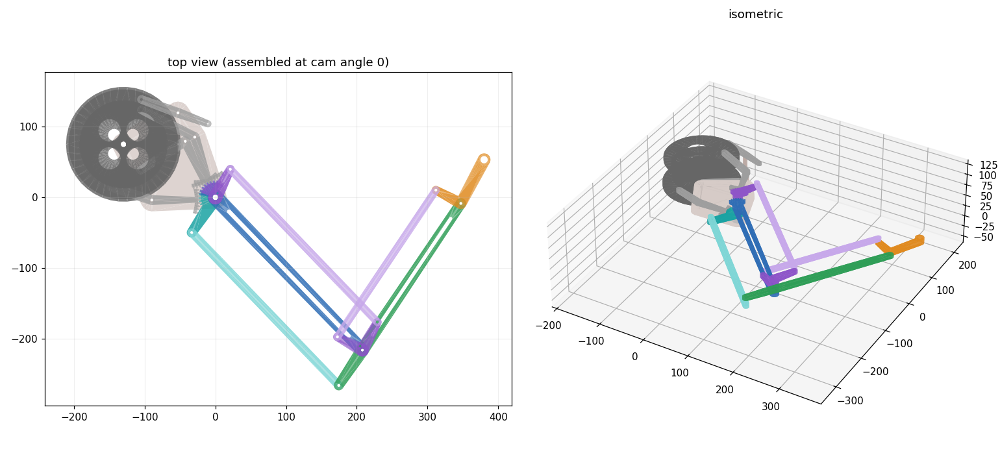
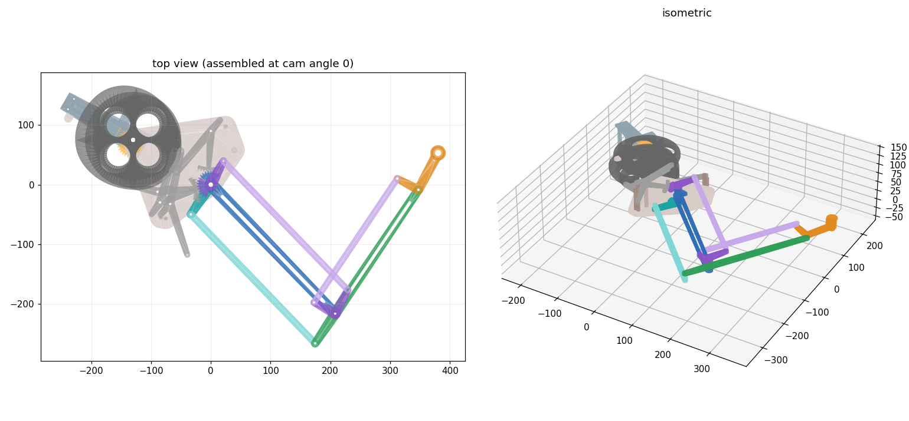
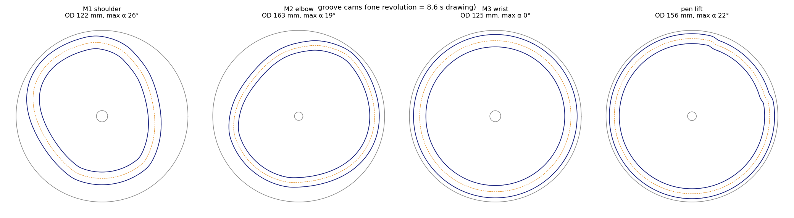

# drawing-arm

A human-like drawing automaton: a planar shoulder–elbow–wrist arm whose
**three input shafts sit coaxially at the shoulder**, with the elbow and wrist
driven remotely through parallelogram linkages, all powered by **one motor**
through a stack of cams. This repo holds the kinematics, motion planning,
cam synthesis, printable parts, structural check and a tkinter simulator.



## Quick start

```
pip install -r requirements.txt
python -m drawarm sim             # simulator (draw with the mouse, load SVG/images)
python -m drawarm test            # numerical self-checks
python -m drawarm cams heart      # encode a drawing onto cams
python -m drawarm parts heart     # printable parts -> output/stl, output/assembly.step
python -m drawarm drum heart --parts   # multi-turn drum instead of cams (+ its parts)
python -m drawarm cartridge heart star # swappable cam stacks for FIXED followers
python -m drawarm machine heart   # the complete single-motor automaton: fixed parts + cam set + BOM
python -m drawarm physics prepare heart && python -m drawarm physics run output/physics/scenario_heart.pkl
python -m drawarm strain heart    # stress / strain / pen-error report
```

`heart` can be any built-in shape (circle, star, spiral, heart, lissajous,
flower, grid), an `.svg` file, or an image. Generated files go to `output/`
(not tracked by git).

**All parameters live in [`params.toml`](params.toml)**: arm lengths, masses,
range-of-motion profiles, planner weights, paper area, gears, rollers, spring
preload, layer thicknesses, link widths, material and load cases.

## Layout

```
params.toml          every parameter (single source of truth)
drawarm/             the Python package
  config.py          loads params.toml, layer map, output folder
  kinematics.py      geometry, human range of motion, FK/IK, dynamics
  planner.py         stroke order, human-like timing, min-energy DP
  inputs.py          SVG / image -> strokes
  shapes.py          built-in drawings, load_drawing()
  cams.py            one-motor cam stack synthesis (+ re-timing)
  drum.py            multi-turn cam drum
  cartridge.py       fixed followers + swappable periphery cam stacks, deflection compensation
  machine.py         complete automaton: carriage, motor + worm, pen lift, stops, BOM
  physics.py         time-domain physics test with Monte-Carlo tolerances
  springs.py         anti-backlash torsion springs
  parts.py           CadQuery parts, STL/STEP export, clearance checks
  structural.py      loads, stress, strain, pen-tip error
  sim.py             tkinter simulator
  selftest.py        self-checks
  __main__.py        command line
docs/
  DESIGN.md          drive options, capacity, structural summary, BOM, printing
  reports/           example spring spec and structural report (heart)
  images/            figures used in the docs
examples/sample.svg  test drawing
hpc/                 Slurm scripts for running the physics Monte-Carlo on a cluster
output/              generated files (git-ignored)
```

## The complete machine

`python -m drawarm machine heart` builds everything for one drawing:
`output/machine/heart/fixed/*.stl` (print once), `cams/*.stl` (the swappable
cam set), `assembly.step` and a [bill of materials](docs/reports/BOM_heart.md).
**One N20 gearmotor** drives a printed worm and worm wheel on the camshaft;
every other motion (shoulder, elbow, wrist and pen lift) comes from the cams.



**Swapping drawings:** the followers are fixed (designed once for a class of
drawings) and only the cam stack changes. Pull the latch pin, slide the cam
carriage out (the rollers park on their stops), lift the cams off the D-shaft,
drop the new set on, index, slide back, latch.

**Physics test:** a time-domain model of the whole machine (motor, worm,
cams, compliant contacts, backlash, springs, arm dynamics, pen drag) with
Monte-Carlo manufacturing tolerances; it runs locally or as a Slurm array
(see [hpc/README.md](hpc/README.md)). It showed that follower-arm and gear
compliance under the spring preload would cost ~1 cm at the pen, so the cams
are now pre-distorted for the predicted deflection: nominal pen error 0.7 mm
RMS, no roller lift-off, no gear load reversals, motor at ~31 % of stall.

## Mechanism

| Input | Drives | Linkage |
|---|---|---|
| M1 | upper arm | direct |
| M2 | forearm (absolute angle) | parallelogram across the upper arm (shoulder crank → coupler → forearm tail): the "5-bar with both inputs at the shoulder" |
| M3 | hand (absolute angle) | parallelogram across the upper arm → free L-shaped bell-crank at the elbow → parallelogram across the forearm → hand crank |

Because every input sets an **absolute** link angle, the kinematics decouple:
turning M1 alone translates the forearm and hand without rotating them.
Default sizes (mm): upper arm 300, forearm 250, hand→pen 70; cranks 60 / 45 / 40.

**Dead points.** A parallelogram can flip into an anti-parallelogram when its
crank lines up with its link. The elbow is kept between 20° and 160° of bend,
and the 90° elbow bell-crank keeps both wrist stages well conditioned. The
simulator shows the transmission margin |sin| for every stage (1 = ideal), and
manual mode lets you drive through a dead point to watch the flip.

## One motor: cams

The drawing is stored in a stack of groove cams on one camshaft (one
revolution = one drawing). Each cam drives one shoulder hub through a 3:1 gear
sector; a fourth cam lifts the pen. Torsion springs on the shoulder axle
preload every hub so gear backlash and groove clearance never move the pen.
The plan is **re-timed** so the arm slows where a cam would be steep, which
shrinks the cams. For drawings too long for one revolution, a **multi-turn
drum** (helical bands, lead screw) holds several turns of track in a much
smaller diameter. See [docs/DESIGN.md](docs/DESIGN.md) for the encoding
options, capacity, the drum, structural results, layer stack, BOM and print
notes.



## Human range of motion

Profiles in `params.toml` (`[[rom.profile]]`, typical adult active ROM):

* shoulder horizontal abduction 45° / adduction 130°, measured from the arm pointing straight out sideways
* elbow flexion 20°–145° (0° is the parallelogram dead point)
* wrist flexion 80° / extension 70° (palm sideways), or radial 20° / ulnar 30° deviation (palm down)

The IK rejects poses outside the profile and adds a quartic *discomfort* cost
that pushes joints toward mid-range, as people do. Green shading in the
simulator shows the reachable pen area.

## Motion planning (`drawarm/planner.py`)

1. **Stroke order**: greedy nearest-neighbour; strokes may be reversed, and closed loops start at their nearest point.
2. **Human-like timing**: pen down follows the **2/3 power law** `v = k·R^(1/3)` (slower in tight curves and corners) with an acceleration limit; pen up is a **minimum-jerk** reach with a Fitts-style duration.
3. **Minimum-energy redundancy resolution**: dynamic programming over the redundant hand angle minimises `∫ [ q̇ᵀ M(q) q̇ + w_c · discomfort(q) + margin penalty ] dt` over the whole job, then smooths and re-solves the arm exactly (10–15 % less kinetic effort than greedy IK).
4. **Dynamics**: exact planar rigid-body model in absolute coordinates, `τ_j = Σ_k H_jk [cos(q_j−q_k) q̈_k + sin(q_j−q_k) q̇_k²]`, plus reflected drive inertia (checked by a power balance in the self-test).

The simulator's **Motors** tab shows range, speed, torque and work per input,
plots the trajectories and exports a CSV.

## Inputs (`drawarm/inputs.py`)

* **SVG**: paths (all commands including arcs), line, polyline, polygon, rect, circle, ellipse, nested transforms
* **Images**: `outline` (brightness iso-contours), `hatch` (tone-dependent cross-hatching), or `both`
* Drawings are scaled to fit the paper (260 × 220 mm, 250 mm in front of the shoulder)

## Not modelled yet

* rotation of the whole arm plane about a vertical axis
* frame / top plate, motor and worm mount, pen-lift cable anchor
* gravity, friction, fatigue
