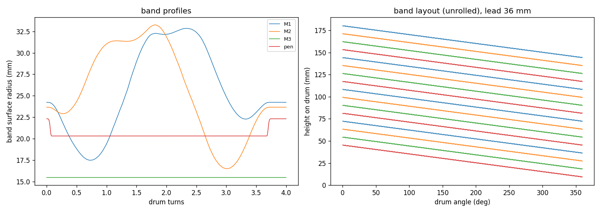
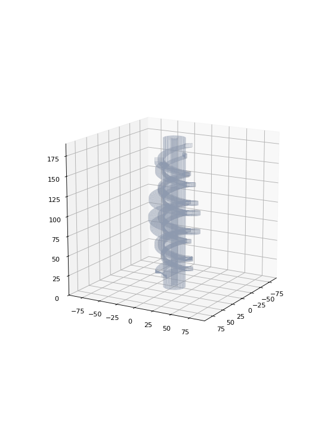

# Drive design: one motor, drawings encoded in the mechanism

## How can the shafts be "programmed"?

| Option | How it stores the drawing | Pros | Cons |
|---|---|---|---|
| **Plate / groove cams on one camshaft** (chosen) | One cam per input shaft (+ pen lift); the cam profile *is* that shaft's angle vs. time. One revolution = one drawing. | Classic automaton approach (Jaquet-Droz, Maillardet); one motor; printable; exact repeatability; swap the cam stack to change the drawing | Limited "capacity": a busy drawing needs huge cams (pressure angle / curvature limits); all strokes must form a closed loop |
| Multi-revolution cams (spiral groove / barrel drum) | Groove spirals so the follower moves along the drum over many turns | Much longer drawings for the same diameter | Harder to print/assemble; follower must translate axially |
| Indexed cam stacks (Maillardet) | Several cam sets on one shaft; shaft shifts axially to select a drawing | Many drawings, one machine | More mechanism (indexing, detents) |
| Gear-train Fourier synthesis | Each shaft = sum of cranks at integer multiples of the base speed (epicycles), summed by linkages/differentials | Smooth, elegant, infinite repeats | Only smooth closed curves; many gears per shaft |
| Coupler-curve linkages (4-bar/6-bar) | Shape comes from link proportions | Very simple | Only a few curve families, not arbitrary images |
| Punched card / pin drum + escapement | Discrete steps per shaft | Reprogrammable | Jerky, low resolution, complex |
| 3 motors (steppers/servos) | Software | Unlimited drawings, trivial to change | Not "one motor", not an automaton |

**Recommendation:** groove cams, one per input shaft, on a single camshaft
driven by one motor through a worm (self-locking, big reduction). Cams are the
only drawing-specific parts; the gears, followers' ratio and arm are shared.
For longer drawings, move to a spiral/barrel cam later.

## Drive train (generated by `drawarm/cams.py` + `drawarm/parts.py`)

```
motor ──worm 1:N──> camshaft O (one rev per drawing)
                      ├─ cam M1 ── roller ── follower M1 (sector z90) ──meshes── upper-arm hub (z30)  3:1
                      ├─ cam M2 ── roller ── follower M2 (sector z90) ──meshes── elbow-crank hub (z30) 3:1
                      ├─ cam M3 ── roller ── follower M3 (sector z90) ──meshes── wrist gear hub (z30)  3:1
                      └─ cam pen ─ roller ── pen lever ── Bowden cable ── pen holder (spring return)
```

All numbers below come from **`params.toml`** – edit it and re-run
`python -m drawarm parts heart` and `python -m drawarm strain heart`.

* **Groove (positive-drive) cams** – the follower can't lift off; roller =
  684ZZ bearing (4×9×4) on a 4 mm stub pin. Groove walls keep a convex radius
  ≥ 3 mm (`min_wall_radius`) to limit contact stress.
* **3:1 gear sectors, module 1.5, 8 mm face** amplify a ±12° follower swing
  into the ±35° the shaft needs. Sectors cover the *whole paper* range, so
  they are reusable for any drawing.
* **Anti-backlash torsion springs** (`drawarm/springs.py`): one around the fixed
  shoulder axle under each hub (keyed collar on the axle's D-flat + leg hole in
  the hub). Hub torque 0.30 / 0.22 / 0.08 N·m (M1/M2/M3) exceeds the most the
  arm ever needs, so gears and cam rollers never change flank → gear backlash
  and groove clearance no longer move the pen. Wire, coils and wind-up are sized
  automatically ([reports/springs_heart.md](reports/springs_heart.md)).
* **Synthesis constraints** per cam: pressure angle ≤ 35°, groove wall radius,
  monotone pitch curve; cams are designed bottom-to-top so each follower's
  pivot standoff clears every cam *and swept follower* below it.
* **Cam-friendly planning** (`plan_for_cams`): gentler accelerations, hand
  angle held steady (often the wrist cam becomes a plain circle, i.e. M3 is
  idle), loop starts on the drawing, closed by a pen-up return, pen ramps of
  8° cam angle overlapping the travel moves.
* **Re-timing** (`[drive].retime`, default 0.7): the camshaft turns at constant
  speed, so a cam is steep wherever the arm moves fast. A time-optimal path
  parameterisation (TOPP) keeps the arm's path but redistributes cam angle so
  every follower's slope *and curvature* on the cam stay within a budget
  (`retime_accel_ratio`), blended with uniform timing and floored so pauses
  don't vanish; every pen lift keeps its 8° of cam. The arm then slows where
  the cams would be steep. `retime = 0` reproduces the old uniform timing.
* **Groove contact limit** (`[drive].max_contact`, 40 MPa): designs whose
  roller-on-groove Hertz pressure (spring preload + running torque) would
  exceed it are rejected, so smaller cams don't come at the cost of worn grooves.

### Capacity (current parameters)

| Drawing | Cycle | Cam ODs, uniform timing, contact ≤ 40 MPa | Cam ODs, re-timed (0.7), contact ≤ 40 MPa |
|---|---|---|---|
| heart | 8.6 s | 153 / 187 / 165 / 156 mm | **142 / 132 / 55 / 155 mm** |
| flower | 13.3 s | infeasible | **208 / 182 / 165 / 155 mm** |
| examples/sample.svg (14 strokes) | 32 s | infeasible | infeasible → use the drum |

(M1 / M2 / M3 / pen.) One revolution holds roughly one or two closed shapes.
The stack-aware pivot placement makes upper cams grow when lower cams are big.

## Multi-turn drum (`drawarm/drum.py`)

`python -m drawarm drum heart [--turns N] [--parts]`



* A vertical drum at the camshaft position turns **N times per drawing** and
  rises one lead per turn on a lead screw (fixed nut; the motor drives it
  through a sliding key/spline).
* Each follower reads a **raised helical band**. From the follower's fixed
  plane a band is just a plate cam unrolled over N turns, so the synthesis,
  re-timing and contact limit are the cam code with θ running 0…2πN.
* Bands are **interleaved like a multi-start thread**. Only a thin **finger**
  (3 mm) with the roller under it enters the drum envelope, so ribs of other
  bands, at other heights modulo the lead, never touch it. Slot per band =
  rib half-width + roller + finger + clearance = 9 mm, lead = 4 × 9 = 36 mm.
* Default `contact = "below_base"`: the drum hangs in a **bay under the base
  plate**; each follower is a rocker on a **steel 8 mm D-shaft** through the
  base plate (sector gear on top, finger at the bottom). The finger stacking
  order is chosen so no rocker shaft crosses another finger; the bay is deep
  enough that the rising drum never reaches the base plate.
* The anti-backlash springs keep the rollers on the bands, so bands are
  single-sided ribs (no grooves).
* End of drawing: reverse the motor (the arm retraces the drawing) or use a
  half-nut and spring to drop the drum back with the followers lifted.

| Drawing | Turns | Drum OD × length | Bay depth | vs. single-turn cams |
|---|---|---|---|---|
| heart | 4 | 67 × 190 mm | 344 mm | cams up to 155 mm |
| flower | 4 | 99 × 190 mm | ~344 mm | cams up to 208 mm |
| examples/sample.svg | 6 | 144 × 262 mm | ~460 mm | impossible on one turn |

Trade-offs: much smaller and far more capacity, but a tall body (the bay),
long rocker shafts, a custom 36 mm-lead screw, and the drum STL is a mesh
(core + overlapping rib shells; slicers union them). Drum-mode parts are in
`output/drum_parts/`.



## Structural check (`drawarm/structural.py`, heart, PLA)

Full report: [reports/strain_heart.md](reports/strain_heart.md).

| item | running (cam drive) | 5 N push on the pen |
|---|---|---|
| links (upper arm, forearm, cranks) | ≤ 0.4 MPa, ≤ 140 µε, SF > 100 | ≤ 4 MPa, ≤ 1300 µε, SF ≥ 11 |
| couplers | SF > 1000, buckling SF ≥ 88 | buckling SF ≥ 4 |
| gears (m1.5, 8 mm, incl. spring preload) | ≤ 7 MPa root, SF ≥ 6, **no load reversal** | ≤ 29 MPa, SF ≥ 1.6 |
| cam grooves (684 roller) | ≤ 38 MPa Hertz (limit 40), **SF ≈ 1.2** | – |
| pen error | 0.6 mm bending, 0.03 mm coupler stretch, 0 backlash | 7 mm elastic |

The cam grooves are the weakest point (preload raises roller force): print
cams in PETG/nylon, or lower `max_contact` (bigger cams). With re-timing the
camshaft needs ≈ 0.29 N·m peak.

## Layer stack

See the docstring in `drawarm/parts.py` and `LAYER` in `drawarm/config.py`. Layer thicknesses
`[9, 8, 9, 8, 6, 7, 8, 7, 6]` mm (gear layers 8 mm = gear face width; layers 0
and 2 are tall enough for the torsion springs), 1 mm washer gaps. Every pin
joins adjacent layers except T2 (layers 2–4), the bell-crank hub (5–7) and the
M3 hub (gear on 6, crank on 7, dowel-keyed). `drive_clearance()` reports every
standoff's clearance (≥ 1.7 mm for the heart).

## Hardware (BOM, approx.)

| Qty | Item |
|---|---|
| 1 | 8 mm steel rod, shoulder axle (~85 mm) **with a D-flat** (stationary, keys the spring collars) |
| 1 | 8 mm steel rod, camshaft (~75 mm, with a flat) |
| ~12 | 4 mm steel pins or M4 shoulder bolts (link joints, follower pivots) |
| 4 | 684ZZ bearings (4×9×4) as cam rollers + 4 mm stub pins |
| 3 | music-wire torsion springs per [reports/springs_heart.md](reports/springs_heart.md) (≈ 1.1–1.4 mm wire, ~20 mm OD) |
| 2 | 3 mm dowels (bell-crank key, M3 hub key) |
| — | 8 mm and 4 mm washers (1 mm) between layers, e-clips/collars |
| 1 | M3 set screw (pen clamp) |
| 1 | small DC gear motor + worm/wormwheel (camshaft ≈ 4–8 rpm, ≈ 0.4 N·m) |
| 1 | Bowden cable + light spring (pen lift) |

## Printing notes

* PLA for links; PETG or nylon recommended for cams and gears. 0.2 mm layers,
  4 perimeters around bores, 40 %+ infill for gears and cams.
* Print every part flat (as exported). Tune `pin_bore`, `axle_bore`,
  `backlash`, `groove_clearance` in `params.toml` for your printer; print one
  hub + follower first to check the mesh.

## Not done yet

* frame / top plate (pivot pins should be supported at both ends), motor mount, worm gear
* pen holder spring and cable anchor on the hand
* "fixed hardware, swappable cams": fix follower arm length / pivot for all
  drawings and only regenerate cams (pivot positions currently re-optimised per drawing)
* collision checks for arm-side parts at the extremes of the human ROM (checked only over the paper)
